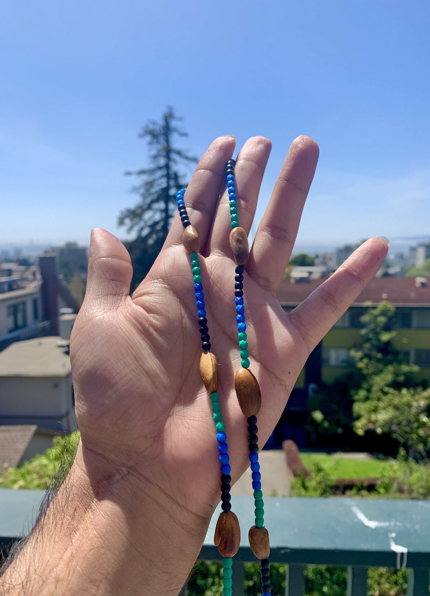
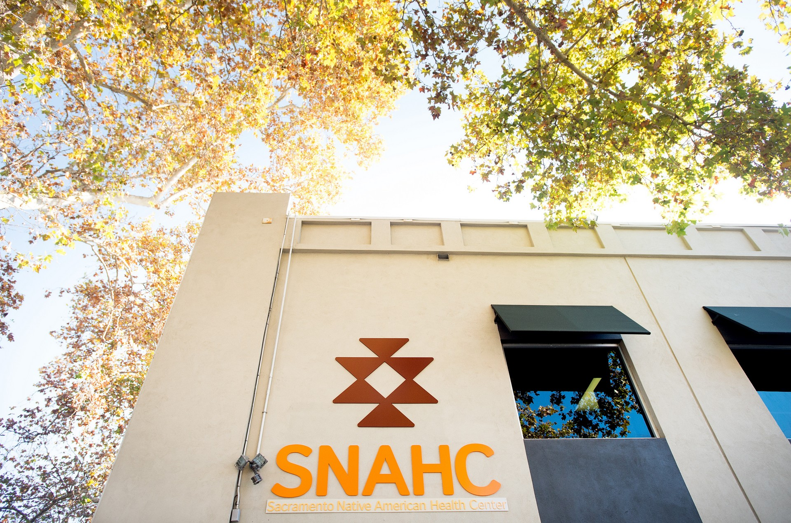
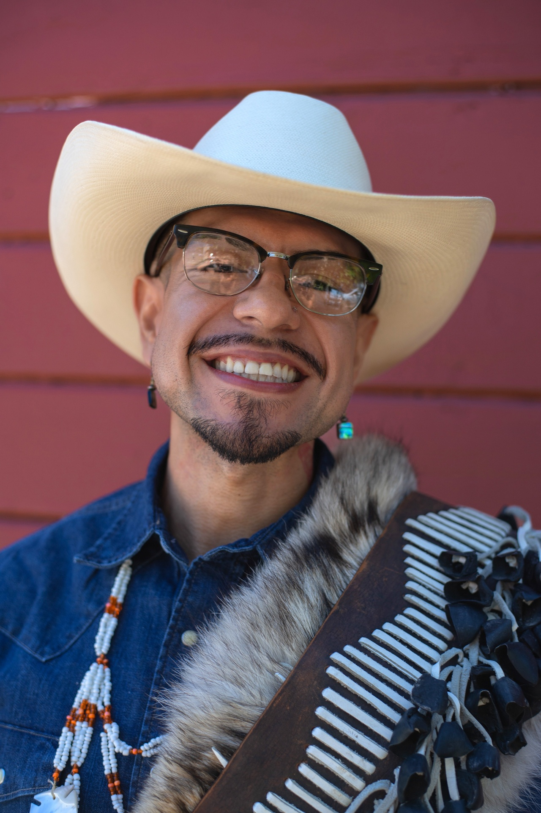

::: {.hopes-split}
::: {}
The Helping Our People End Suicide (HOPES) Study engaged the Sacramento Native American community and staff at the Sacramento Native American Health Center (SNAHC) about the appropriateness and feasibility of developing and utilizing a culture-based suicide screening assessment. The study aimed to prevent suicide among Native American youth in the Sacramento community by promoting culturally relevant assessments and resulting care coordination and planning.

The HOPES Study was a community-based participatory research project. It centered the youth voice and family perspective throughout the development of the new suicide screener. Youth, community and family members, as well as SNAHC staff were invited to participate. Personal experiences and community knowledge were essential in gaining a comprehensive understanding of how to best recognize and prevent suicide.
:::

{fig-alt="A raised hand holding a strand of blue, green, and wooden beads against the sky."}
:::

## Frequently Asked Questions {#faq}

[]{#sec-76d0}

### Who participated in the study?

Youth, community and family members, as well as SNAHC staff were invited to participate in the HOPES Study.

**Youth Participant Eligibility:**

- Self-identify as Native American or Indigenous
- Aged 13 - 24 years old; Minors aged 13-17 years old, consent of a parent or legal guardian was required
- Primary residence in Sacramento County

**Community Member Participant Eligibility:**

- Self-identify as Native American or Indigenous
- Over the age of 25 years old
- Primary residence in Sacramento County

**SNAHC Staff Member Participant Eligibility:**

- Current employee at SNAHC
- Over the age of 18 years old

### What kind of information was collected?

The HOPES Study was a mixed-methods study that used both qualitative and quantitative methods. Qualitative data involves peoples’ stories and personal experiences. Quantitative data includes numbers and statistics.

Qualitative data was gathered using one-on-one interviews. Focus groups were also used. Quantitative data was gathered using surveys and questionnaires. For both kinds of data, participants were asked about their opinions on current suicide screening protocols. Participants were also asked about their ideas on how to improve culturally responsive care. Questions about suicide stigma were also asked.

### When will the HOPES Screener tool be used?

Please visit our [Screener Tool](Screener-Tool.qmd) webpage to view the tool developed as part of the HOPES Study.

The HOPES Screener tool is currently in the evaluation and validation phase. SNAHC staff and research study teams are working to determine the most effective implementation strategies for the screener tool. This careful planning ensures that the HOPES Screener tool aligns with SNAHC's commitment to providing the highest level of culturally competent care to all its patients. The tool will be implemented once it has been thoroughly validated to meet the needs of the Sacramento Native American community.

### Why is preventing suicide important?

Suicide remains an urgent mental health disparity for Native American young people. According to the Centers for Disease Control and Prevention, suicide is the leading cause of non-accidental death for youth ages 10 through 24. Compared to other ethnic-racial groups, suicide impacts Native American communities at the highest rate. Several studies also point out that suicide is more common in urban Native American communities. These statistics remain true in Sacramento County which is home to one of the many large, urban communities of Native American people in California. The HOPES Study looked to end suicide by identifying early warning signs and connecting youth in need of extra support to the necessary clinical and cultural services.

## More Information

::: {.hopes-downloads}
::: {.hopes-download}
### Project Narrative

Learn more about the HOPES Study including guiding theories, research questions, and academic references.

[Download Now](files/HOPESProjectNarrative12.22.pdf){.btn .btn-primary}
:::

::: {.hopes-download}
### Information for Parents

Learn more about youth participation in the HOPES Study.

[Download Now](files/HOPESParentInfo04.27.23-2.pdf){.btn .btn-primary}
:::
:::

## Collaborations & Researchers {#collaborations}

[]{#sec-05d7}

::: {.hopes-split}
::: {}
### Sacramento Native American Health Center, Inc.

SNAHC is a non-profit 501(c)(3) Federally Qualified Health Center committed to continue and share the legacy of a healthy American Indian / Alaska Native community based on cultural values delivered through a traditional, innovative and accessible patient-centered health home. SNAHC offers primary care, oral health, behavioral health, specialty, and supportive services in midtown Sacramento. We are open to all, and all are welcome. For more information on SNAHC, visit [www.snahc.org](https://www.snahc.org) or call [916-341-0575](tel:916-341-0575) for an appointment.
:::

{fig-alt="The Sacramento Native American Health Center building, with its logo and SNAHC sign, beneath autumn trees."}
:::

::: {.hopes-split}
::: {}
### Valentín Quiroz de la Sierra, Ph.D

Dr. Val earned his Ph.D. from the UC Berkeley School of Social Welfare. Dr. Val’s clinical and research agendas focus on eliminating mental health disparities, particularly suicide and depression, for urban Native American young people through culturally grounded practices and interventions. He holds a M.S.W. from Berkeley Social Welfare and a B.A. in Native American Studies, with highest honors, from UC Davis. He is an Associate Clinical Social Worker and an active member of the California Yo’eme (Yaqui) Indian community.
:::

{fig-alt="Portrait of Valentín Quiroz de la Sierra, smiling, in a cream cowboy hat and glasses."}
:::

## Contact {#contact}

[]{#sec-ca10}

Please direct questions about the HOPES Study to Dr. Val at [vsierra4@jh.edu](mailto:vsierra4@jh.edu).

If you have any questions or concerns about your rights and treatment as a participant, you can contact UC Berkeley's Committee for the Protection of Human Subjects, at [(510) 642-7461](tel:510-642-7461) or [subjects@berkeley.edu](mailto:subjects@berkeley.edu).
