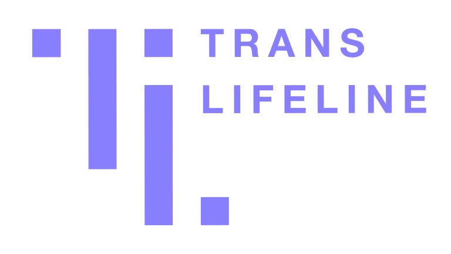

::: {.hopes-resource}
[{fig-alt="988 Suicide and Crisis Lifeline logo"}](https://988lifeline.org/)

::: {}
### [988 Suicide & Crisis Lifeline](https://988lifeline.org/)

::: {.hopes-action}
Call or text [988](tel:988)
:::

The 988 Suicide & Crisis Lifeline provides 24/7, free and confidential support for people in distress, and prevention and crisis resources for you or your loved ones.
:::
:::

::: {.hopes-resource}
[{fig-alt="Crisis Text Line logo"}](https://www.crisistextline.org/)

::: {}
### [Crisis Text Line](https://www.crisistextline.org/)

::: {.hopes-action}
Text HOME to [741-741](sms:741741)
:::

Crisis Text Line is here for any crisis. A live, trained Crisis Counselor receives the text and responds, all from our secure online platform. The volunteer Crisis Counselor will help you move from a hot moment to a cool moment.
:::
:::

::: {.hopes-resource}
[{fig-alt="The Trevor Project logo"}](https://www.thetrevorproject.org/)

::: {}
### [The Trevor Project](https://www.thetrevorproject.org/)

::: {.hopes-action}
Call [1-866-488-7386](tel:1-866-488-7386)
:::

The Trevor Project is the leading national organization providing crisis intervention and suicide prevention services to lesbian, gay, bisexual, transgender, and questioning youth. These include a hotline and online, crisis intervention chat service.
:::
:::

::: {.hopes-resource}
[{fig-alt="Trans Lifeline logo"}](https://translifeline.org/)

::: {}
### [Trans Lifeline](https://translifeline.org/)

::: {.hopes-action}
Call [1-877-565-8860](tel:1-877-565-8860)
:::

Trans Lifeline connects trans people to the community support and resources we need to survive and thrive.
:::
:::

::: {.hopes-resource}
[{fig-alt="Find A Helpline logo"}](https://findahelpline.com/us/topics/suicidal-thoughts)

::: {}
### [Find A Helpline](https://findahelpline.com/us/topics/suicidal-thoughts)

::: {.hopes-action}
Visit [findahelpline.com](https://findahelpline.com/us/topics/suicidal-thoughts)
:::

Global list of helplines, hotlines & crisis lines. Get emotional support with suicidal thoughts, gender & sexual identity, depression, loneliness, and anxiety.
:::
:::
