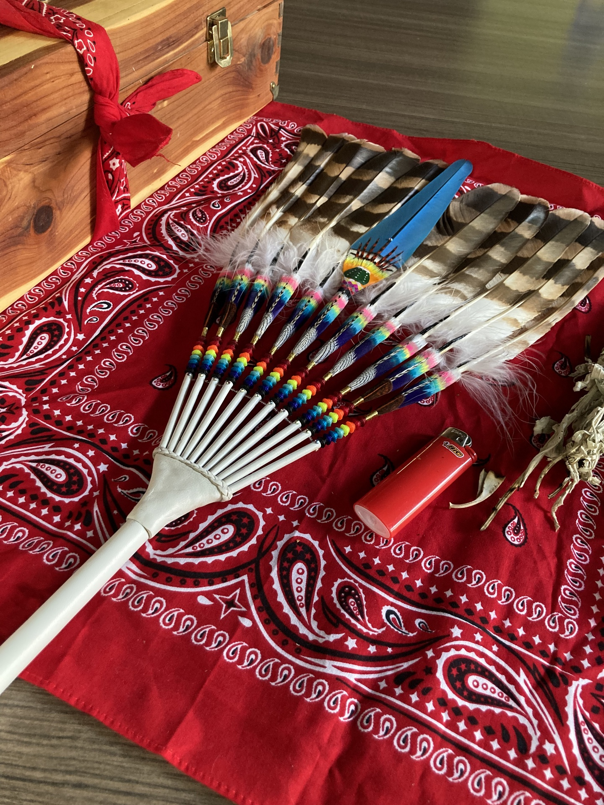
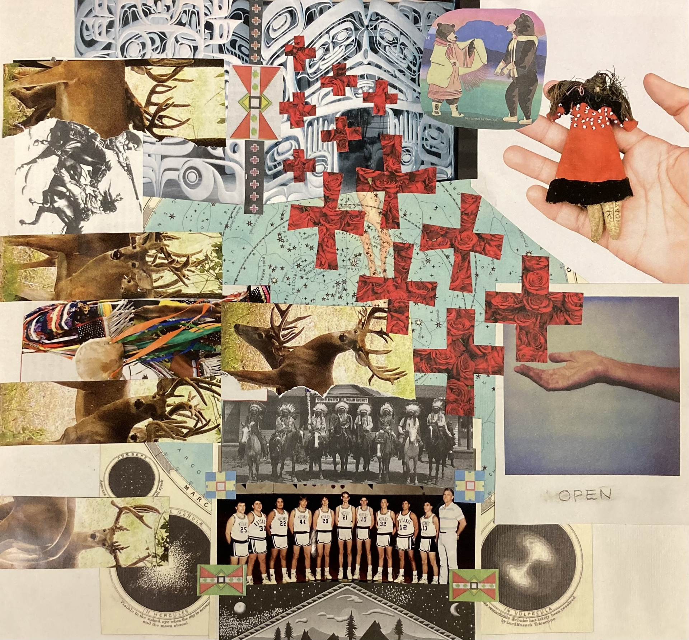

This screener was developed through the HOPES Study and is still being evaluated. It is shared for informational purposes and is not a substitute for professional care. If you or someone you know is in crisis, call or text [988](tel:988).

[Download Now](files/HOPESScreener06.10.24.pdf){.btn .btn-primary}

Do you have questions? Please visit the [Frequently Asked Questions](About.qmd#faq) section on our [About](About.qmd) webpage to learn more about the HOPES Study.

::: {.hopes-screener-images}
{fig-alt="A beaded feather fan and a lighter resting on a red bandana beside a wooden box."}

{fig-alt="A collage of deer, hands, historical photographs, and red crosses."}
:::
